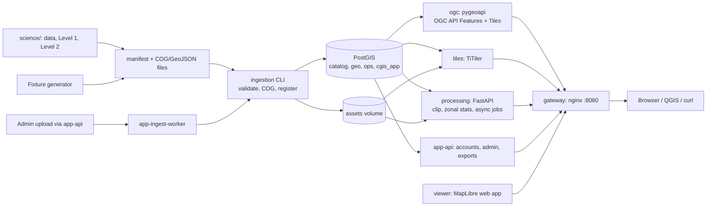

# CyberGIS population data platform

This repository is a containerised platform for storing, cataloguing, publishing, processing and
viewing population rasters and boundary polygons, together with the scientific pipelines that
produce the rasters. It runs locally with Docker Compose. It has these parts:

- **Platform:** ingestion with validation and COG conversion, a PostGIS catalog, OGC API
  Features/Tiles, raster tiles, and clipping, zonal statistics and exports.
- **Application:** an application API (accounts, admin uploads and publication, exports) and a
  MapLibre web application.
- **Science pipelines** (`science/`):
  - data acquisition and harmonisation;
  - Level 1, India-wide ~100 m dasymetric redistribution of WorldPop;
  - Level 2, census-constrained fine-resolution town models.

> **Synthetic vs real data.** The test fixtures are deterministic **SYNTHETIC** values: not
> population estimates and not WorldPop data. Real inputs (WorldPop, GHSL, census, boundaries) are
> downloaded by the science tools and are never committed. Everything synthetic is labelled
> `SYNTHETIC` / `deterministic-fixture` wherever it appears.

## Contents

1. [Architecture](#architecture)
2. [Repository layout](#repository-layout)
3. [Quick start](#quick-start)
4. [Process: from file to API](#process-from-file-to-api)
5. [Modules](#modules)
6. [Science pipelines](#science-pipelines)
7. [Synthetic fixtures and expected answers](#synthetic-fixtures-and-expected-answers)
8. [Testing](#testing)
9. [Operations, configuration and troubleshooting](#operations-configuration-and-troubleshooting)
10. [Loading real data](#loading-real-data)
11. [Rules and limitations](#rules-and-limitations)

## Architecture



Design rules:

- **Rasters stay files; metadata lives in PostGIS.** Rasters are Cloud Optimised GeoTIFFs on the
  `assets` volume. PostGIS holds the dataset catalog, boundary polygons (GiST-indexed), jobs and
  application accounts. Clients only ever send a `dataset_id`; services resolve the server-side file
  through the catalog and never accept a client path or URL.
- **One importer, one metadata contract.** Nothing is keyed on years, regions, the WorldPop name or
  dataset ids. CRS, bounds, resolution and NoData are read from the file, never trusted from the
  manifest. Synthetic fixtures, science outputs and admin uploads all go through the same importer.
- **Versioned, safe ingestion.** A dataset becomes `ready` only after its asset and metadata are
  verified. Re-imports are idempotent. A higher ready version becomes current, and older versions,
  along with their boundary units, are kept.
- **Standards only where claimed.** `/ogc/` is a real OGC API (Features + Tiles, verified with the
  OGC CITE suites). `/tiles/` (TiTiler), `/api/operations` (processing) and the application routes
  are labelled vendor-specific or custom. OGC API Coverages and Processes are not claimed.
- **Least privilege.**
  - Only the gateway publishes a port (127.0.0.1:8080).
  - Each service has its own database role: `ogc`/`tiles` are read-only.
  - Only `ingestion` and `app-ingest-worker` write assets.
  - Admin writes are always authenticated.

### Services (`compose.yaml`)

| Service | Built from | Role |
|---|---|---|
| `volume-init` | busybox | One-shot: hands every named volume to the non-root service user (uid 10001). |
| `db` | `postgis/postgis:17-3.5` | PostgreSQL 17 + PostGIS 3.5 in the `pgdata` volume; no host port. |
| `migrate` | `database/` | One-shot `python -m cgis_db.setup`: waits for `db`, applies migrations, creates service login roles. |
| `ingestion` | `ingestion/` | Tool container (`tools` profile): fixture generator and importer. |
| `tiles` | `ogc-services/tiler/` | Restricted TiTiler for catalog rasters; `assets` read-only. |
| `ogc` | `ogc-services/pygeoapi/` | pygeoapi; config regenerated from the catalog. |
| `processing` | `spatial-processing/` | FastAPI processing API plus async job workers. |
| `app-migrate` | `application-api/` | One-shot (profile `app`): app schema, roles, read grant for OGC, bootstrap accounts. |
| `app-api` | `application-api/` | Application API (profile `app`). |
| `app-ingest-worker`, `app-export-worker` | `application-api/` | Background workers for admin uploads and exports (profile `app`). |
| `viewer` | `demo-client/` | Static MapLibre web application. |
| `gateway` | `infra/gateway/` | nginx, the single entry point. |
| `level1` | `science/level1/` | Level 1 national model run (profile `science`, run alone). |
| `e2e` | `tests/e2e/` | Test runner (profile `e2e`), used by `tests/run.sh`. |

Start order is enforced with health conditions:

1. `volume-init` completes and `db` is healthy.
2. `migrate` completes, then `app-migrate` if the app profile is on.
3. `tiles` is healthy, then `ogc` starts.
4. `processing`, `viewer` and `app-api` are healthy, then `gateway` starts.

Health checks report readiness (database reachable, volume mounted, workers alive), not just a
running process.

### Gateway routes (`infra/gateway/default.conf`)

| Path | Upstream | Methods | What |
|---|---|---|---|
| `/` | — | GET | 302 to `/viewer/` |
| `/viewer/` | `viewer` | GET/HEAD | Web application |
| `/ogc/` | `ogc` | GET/HEAD | OGC API landing, conformance, collections, items, tiles, OpenAPI |
| `/tiles/` | `tiles` | GET/HEAD | **Vendor-specific** TiTiler routes |
| `/api/operations`, `/api/downloads`, `/api/health`, `/api/ready`, `/api/docs` | `processing` | all | Custom processing API, 1 MiB body limit |
| `/auth/`, `/admin/`, `/api/exports`, `/api/catalog/`, `/api/app/` | `app-api` | all | Application API. Without the `app` profile these return 503 `APP_API_UNAVAILABLE`. |
| `/healthz` | — | GET | Gateway liveness |
| anything else | — | — | JSON 404 |

How the gateway handles requests:

- **Paths.** `/ogc`, `/tiles`, `/api` and `/viewer` strip their prefix using the raw request URI,
  so percent-encoding and query strings arrive unchanged. Application routes are forwarded as-is.
- **Host header.** The client's `Host` is forwarded so services build links back through the
  gateway. `PUBLIC_BASE_URL` must match how clients reach it.
- **Redirects.** Prefix redirects (`/ogc` → `/ogc/`) are absolute, because QGIS does not follow
  relative ones.
- **Refusals.** Dot-segment paths get 400 and writes to read-only prefixes get 403.
- **Uploads.** Admin uploads stream to the app (no 1 MiB cap, no buffering).
- **Logs.** Access logs are JSON lines without query strings.
- **Upstreams.** They are resolved per request through the container DNS, so a recreated backend
  is picked up without a gateway restart.
- **Read access** (`GATEWAY_READ_ACCESS`, applied at start by `40-cgis-gateway.sh`):
  - `public` (default): `/ogc/`, `/tiles/` and `/api/` reads are anonymous.
  - `protected`: those reads need a signed-in session or a personal access token, checked by
    nginx `auth_request` against `app-api GET /auth/verify`.

### Volumes

| Volume | Mounted by | Contents |
|---|---|---|
| `pgdata` | `db` | PostgreSQL cluster |
| `assets` | rw: `ingestion`, `app-ingest-worker`; ro: `tiles`, `processing`, `app-api`, `app-export-worker` | `rasters/<id>/v<n>/<id>_v<n>.tif`, `vectors/<id>/v<n>/<id>_v<n>.geojson` |
| `processing-outputs` | `processing` | Clip/export results of the processing API |
| `app-staging` | `app-api`, `app-ingest-worker` | Admin uploads awaiting validation/publication |
| `app-exports` | `app-export-worker` (rw), `app-api` (ro) | Export job outputs (expire after `APP_EXPORT_TTL_SECONDS`) |
| `./data/fixtures` (bind) | `ingestion`, `e2e` | Generated fixtures and test evidence (git-ignored) |
| `./data/incoming` (bind, ro) | `ingestion` | Real deliveries to import |
| `./data` (bind) | `level1` | Science inputs and outputs (git-ignored) |

`docker compose down` keeps the volumes. Only `down -v` (`make reset CONFIRM=1`) deletes them.

## Repository layout

```
compose.yaml, Makefile, .env.example   stack definition, task shortcuts, configuration template
infra/gateway/                         nginx gateway image, routes, start-up script
infra/scripts/                         init-env.sh (create/extend .env), smoke.sh (route check)
infra/compose.db-port.yaml             opt-in override publishing the DB on 127.0.0.1:55432
database/                              PostGIS migrations, cgis_db CLI, migrate image
ingestion/                             fixture generator + importer (python -m ingestion.cli)
ogc-services/pygeoapi/                 OGC API Features/Tiles (pygeoapi + cgis_ogc)
ogc-services/tiler/                    restricted TiTiler (cgis_tiler)
spatial-processing/                    FastAPI clip / zonal statistics / async jobs / downloads
application-api/                       accounts, admin uploads/publication, exports (cgis_app)
demo-client/                           MapLibre web application (+ its unit and browser tests)
science/                               data acquisition, Level 1 and Level 2 pipelines, results
tests/run.sh, tests/e2e/, tests/bench/ test runner, end-to-end suite, national benchmark
```

Each module has its own dependency pins (`requirements.txt` or `pyproject.toml`) and Dockerfile.

## Quick start

Requirements:

- Docker Engine 24+ with Compose v2.24+ (Docker Desktop on Windows/macOS), or Podman with the
  Docker Compose plugin.
- About 6 GB of disk, plus data.
- 8 GB of RAM (16 GB for national data).
- `curl` and a POSIX `sh` (Git Bash on Windows). `make` is optional.

```sh
sh infra/scripts/init-env.sh              # .env with random local passwords (never commit it)
docker compose --profile tools build      # all images incl. the ingestion tool   (make build)
docker compose up -d --wait               # start and wait for health             (make up)
docker compose run --rm ingestion seed    # generate + import SYNTHETIC fixtures  (make seed)
sh infra/scripts/smoke.sh                 # every route reaches a ready service   (make smoke)
```

Open <http://localhost:8080/viewer/> and sign in with `APP_BOOTSTRAP_ADMIN_USERNAME` /
`APP_BOOTSTRAP_ADMIN_PASSWORD` from `.env` for admin features. Useful URLs:

| URL | What |
|---|---|
| `/ogc/collections` | Published datasets |
| `/ogc/collections/synthetic-towns/items` | Town polygons (OGC API Features) |
| `/ogc/collections/synthetic-worldpop-2001/tiles` | Raster tilesets (OGC API Tiles) |
| `/ogc/TileMatrixSets`, `/ogc/conformance`, `/ogc/openapi` | OGC metadata |
| `/tiles/datasets` | TiTiler dataset list with render metadata (vendor-specific) |
| `/api/docs`, `/api/app/docs` | Processing API and application API docs |

Example requests:

```sh
curl -s 'localhost:8080/ogc/collections/synthetic-towns/items?bbox=78.009,17.979,78.021,17.991&f=json'
curl -s -X POST localhost:8080/api/operations/zonal-statistics -H 'content-type: application/json' -d '{
  "dataset_id": "synthetic-worldpop-2001", "aoi_crs": "EPSG:4326",
  "aoi": {"type": "Polygon", "coordinates": [[[78.01,17.98],[78.02,17.98],[78.02,17.99],[78.01,17.99],[78.01,17.98]]]}}'
# -> "count_valid": 100, "sum": 100, "mean": 1.0, "units": "people_per_cell", ...
```

`make help` lists every target: `env config build up down restart ps logs migrate fixtures import
seed smoke e2e test-modules bench reset`.

## Process: from file to API

1. **Setup.**
   - `migrate` waits for PostgreSQL and applies `database/migrations`. Each migration runs in its own
     transaction, under an advisory lock, and is checksummed.
   - It then creates one login role per service in the matching group role (`cgis_ingest`,
     `cgis_reader`, `cgis_processing`).
   - With the app profile, `app-migrate` adds the `cgis_app` schema, its roles, the read grant that
     lets OGC withhold admins-only datasets, and the bootstrap accounts.
2. **Produce inputs.** Each source writes a `manifest.json` next to its files:
   - the fixture generator (`ingestion generate-fixtures`);
   - the science pipelines, for real Level 1/Level 2 rasters and boundaries;
   - an admin upload through the application API.
3. **Validate.** `ingestion validate` checks each entry against its file:
   - an EPSG CRS and a north-up transform;
   - declared NoData, with every pixel block readable (in bounded row bands for single-strip
     national rasters), no undeclared NaN, and at least one valid cell;
   - vectors must be valid Polygon/MultiPolygon GeoJSON;
   - optional `expect` values are compared with the file.
4. **Import.** Each dataset is imported under an advisory lock on `(dataset_id, version)`:
   - Same version already `ready` with the same checksum → `unchanged` (the asset is re-verified).
     A different checksum → `checksum_conflict`, and nothing is touched.
   - Otherwise the row is written as `staged`. The COG (DEFLATE + predictor, 512 px tiles, nearest
     overviews) or normalised GeoJSON is built in `assets/.staging/` and verified pixel by pixel.
   - The file is placed with a no-clobber link. Units are upserted into `geo.admin_units` (per
     dataset version) and the row is set to `ready`, in one transaction.
   - Any failure removes this attempt's files and marks the row `failed`
     (`provenance.ingestion.error`). A retry reuses the row.
5. **Publish.**
   - `catalog.current_datasets` exposes the highest `ready` version of each id.
   - `ogc` regenerates its pygeoapi configuration from it every `OGC_REFRESH_INTERVAL` seconds, so
     new datasets appear without editing config.
   - Rasters get OGC API Tiles tilesets, rendered with a shared display scale from
     `catalog.render_profiles` where one matches. Vectors get Features collections scoped to their
     current version.
6. **Process.**
   - `processing` resolves the `dataset_id`, transforms the AOI to the raster's native CRS, selects
     pixels by centre (`all_touched=false`) and excludes NoData.
   - It returns statistics or writes a GeoTIFF/COG with a job record in `ops.jobs`.
   - Large AOIs run as background jobs, processed block by block.
7. **Use.**
   - The web application browses, compares and analyses layers, and signed-in users export data.
   - QGIS reads the OGC endpoints directly.

## Modules

### `database/`: PostGIS schema

**Layout**

- `cgis_db/`: the CLI, migration runner, query wrappers, fixture loader, EXPLAIN tool and the
  `setup` entry point of the migrate image.
- `migrations/core/0001…0009`: extensions, common helpers, catalog, geo, ops, access roles,
  versioned admin units, render profiles and the job queue.
- `migrations/raster_demo/`: an optional PostGIS Raster comparison track.

**Tables and views**

- **`catalog.datasets`**
  - PK `(dataset_id, version)`; slug `^[a-z0-9]([a-z0-9._-]{0,126}[a-z0-9])?$`.
  - `kind`: raster or vector. `product_level`: source, level1, level2 or other. `status`: staged,
    ready or failed.
  - `crs` is `EPSG:n` and must exist. `bbox` is a GiST-indexed `Polygon,4326`.
  - `asset_path` is a safe relative path under `/data/assets`.
  - Ready rows need a bbox and checksum; ready rasters also need `asset_path`, `units` and a
    resolution. Ready rows are immutable; to withdraw a version, set it to `failed`.
  - `catalog.register_dataset(jsonb)` is an idempotent writer.
- **`catalog.current_datasets`**: the highest ready version per id, with the same columns. It is
  written as a `NOT EXISTS` anti-join so filters reach the indexes.
- **`geo.admin_units`** (0007)
  - Identity is `UNIQUE NULLS NOT DISTINCT (dataset_id, dataset_version, unit_id)` with a
    surrogate PK `unit_key`. Each dataset version keeps its own units, and units of a ready version
    are immutable.
  - `geo.current_admin_units` returns the units of each dataset's current version.
  - Also `geo.dataset_units(id, version)` and `geo.unit_versions(id, unit_id)`.
  - Writes go through `geo.upsert_admin_unit` → `geo.normalize_multipolygon`. It requires an
    explicit SRID, transforms to 4326, forces 2D Multi and rejects invalid or empty geometry. It
    repairs only when asked.
- **`ops.jobs`**
  - Lifecycle `queued → running → completed | failed`. `error` is set if and only if the job failed.
  - 0009 adds `execution` (sync/async), `attempts`, `max_attempts`, `progress`, `heartbeat_at`,
    `worker_id` and `cancel_requested`.
  - Workers claim jobs with `FOR UPDATE SKIP LOCKED`. Only async jobs may go back from `running`
    to `queued`.
- **`catalog.render_profiles`** (0008): fixed display scales. `catalog.render_profile_for(id,
  version)` picks a profile only when the units match. Display only; values never change.
- **Roles** (0006): `NOLOGIN` groups `cgis_reader` (read), `cgis_ingest` (catalog/geo writes) and
  `cgis_processing` (read + `ops.jobs`).
- **Spatial primitives**: STABLE SQL functions such as `catalog.datasets_in_bbox`,
  `geo.units_in_bbox`, `geo.units_intersecting`, `geo.units_covered_by`, `geo.unit_overlap` and
  `geo.summarize_units`. They transform only the query geometry, so GiST stays usable.

**CLI**

Run as `python -m cgis_db`. The connection comes from `--dsn`, `CGIS_DATABASE_URL`, `DATABASE_URL`
or `PG*`. Exit codes: 0 ok, 1 error, 2 usage. `CGIS_DB_MIGRATIONS_DIR` overrides the SQL location.

- `migrate up|down|status [--track core|raster_demo] [--target N] [--steps N]`
- `fixtures load [--geojson PATH]` loads the stub towns without the importer.
- `raster-demo [--tile-size 16]` runs the optional PostGIS Raster demo.
- `explain [--grid 150] [--datasets 5000]` prints EXPLAIN plans on a synthetic load and rolls it
  back.

**Rules**

- Never edit an applied migration; the checksums detect it. Add a new one instead.
- Down scripts never `CASCADE`.
- Rollbacks of 0007 and 0009 refuse, changing nothing, while data depends on them.
- Requires PostgreSQL ≥ 14 and PostGIS ≥ 3.1.

**Findings**

- Bbox and intersect queries and `current_datasets` use the GiST indexes. Wrapping the indexed
  column in `ST_Transform` forces a sequential scan, so transform the query geometry instead.
- The PostGIS Raster demo reproduces the fixture sums with pixel-centre selection. `touched=true`
  undercounts at tile seams, so COG files remain the primary raster store.

### `ingestion/`: fixtures and importer

Run as `python -m ingestion.cli` (the image entrypoint):

| Command | What |
|---|---|
| `generate-fixtures [--out-dir DIR]` | Write the SYNTHETIC fixtures |
| `validate --manifest PATH [--only ID] [--fail-fast]` | Check a manifest; writes nothing, needs no DB |
| `import --manifest PATH [--assets-dir D] [--dsn DSN] [--wait-db S] [--only ID]… [--fail-fast]` | Import |
| `seed [--fixtures-dir DIR] [...]` | Generate, then import the fixtures (idempotent) |

**Output and exit codes.** Each dataset produces one JSON line on stdout with an `outcome`:
`imported`, `unchanged`, `validated` or `failed` (with `error.code`/`error.message`). Logs go to
stderr. Exit codes: 0 ok, 1 a dataset failed, 2 bad manifest, 3 database unavailable or not migrated.

**Environment.**

- DSN: `--dsn`, then `INGESTION_DATABASE_URL`, `DATABASE_URL`, then `PG*`.
- `INGESTION_ASSETS_DIR` (`/data/assets`), `INGESTION_FIXTURES_DIR` (`/data/fixtures`).
- `INGESTION_DB_WAIT_SECONDS`, `INGESTION_LOG_LEVEL`.

**Manifest.** A single object, a list, or `{"datasets": [...]}`. Relative `file` paths resolve
against the manifest's directory. Template: `ingestion/manifest.template.json`.

| Field | Notes |
|---|---|
| `dataset_id` | Lowercase slug, ≤ 128 chars |
| `version` | Integer ≥ 1 |
| `title`, `kind` (`raster`/`vector`), `product_level` (`source`/`level1`/`level2`/`other`), `source`, `file` | Required |
| `units` | Required for rasters, e.g. `people_per_cell`; counts and densities are never treated alike |
| `year`, `description`, `provenance` (object), `band` (default 1), `checksum_sha256`, `allow_missing_nodata` | Optional |
| `expect` | Optional assertions: `crs`, `width`, `height`, `band_count`, `dtype`, `nodata`, `resolution`, `bounds`, `tolerance`, `feature_count` |
| `id_property`, `name_property`, `level_property`, `unit_id_prefix` | Vector property mapping (defaults `unit_id`, `name`, `level`, `""`) |

Validation rules:

- Synthetic datasets must say SYNTHETIC in the title. Unknown keys produce a warning and are kept
  in `provenance.manifest_extra`.
- `provenance.group_id` groups per-town Level 2 datasets.
- `provenance.ogc_publication` holds optional publication hints.
- Vector input is GeoJSON only; a legacy `crs` member is reprojected to EPSG:4326. Invalid geometry
  is rejected, never repaired.
- Rotated rasters and rasters without an EPSG code are rejected, e.g. GHSL Mollweide
  (ESRI:54009): reproject it first.

**Python API.** The app worker and the science code reuse `ingestion.importer.Importer`,
`ingestion.catalog`, `ingestion.manifest`, `ingestion.raster` and `ingestion.importer.sha256_file`.

### `ogc-services/`: OGC API and tiles

There are two images:

- **`ogc`**: pygeoapi 0.24.0 plus the `cgis_ogc` package (gunicorn `:5000`, gateway `/ogc/`). It
  serves OGC API Features for vector datasets and OGC API Tiles (PNG map tiles) for raster datasets.
- **`tiles`**: a restricted titiler.core 2.4.0 app, `cgis_tiler` (uvicorn `:8000`, gateway
  `/tiles/`). It serves the vendor routes and renders the tiles behind OGC API Tiles.

**Publication.** `python -m cgis_ogc.publish` runs at startup and every `OGC_REFRESH_INTERVAL`
seconds. It regenerates the config and OpenAPI document, and reloads gunicorn only when they changed.

- **Raster datasets** become tilesets in WebMercatorQuad and WorldCRS84Quad. The zoom range comes
  from the catalog resolution (+2 over-zoom).
- **Vector datasets** become Features collections over `geo.admin_units`. Each collection is scoped
  to the dataset's current ready version, and withdrawing a version republishes the previous one.
- **Paging.** Item lookup, `numberMatched` and prev/next links stay inside the collection. A
  `limit` above 1000 is throttled, not truncated.
- **Access.** Datasets with `access='admins'` in `cgis_app.dataset_access` are not published. If
  that table exists but cannot be read, refresh fails closed.
- **Display scale.** It comes from the matching render profile, else the
  `provenance.ogc_publication.render.rescale` hint, else a per-dataset autoscale labelled
  "diagnostic, not comparable". Seeded profiles:

  | Profile | Range | Matches |
  |---|---|---|
  | `level1-people-per-cell` | 0..50 | `product_level=level1` |
  | `worldpop-people-per-cell` | 0..50 | `india-worldpop-unconstrained-YYYY[-region]` |
  | `ghsl-pop-people-per-cell` | 0..50 | `india-ghsl-pop-YYYY[-region]` |
  | `ghsl-built-m2-per-cell` | 0..10000 | built-up rasters (`m2_per_cell`) |
  | `level2-people-per-cell` | 0..2.76125 | `product_level=level2` (same density on the 23.5 m grid) |

  Why these ranges: 50 people per ~1 ha cell ≈ 5000/km², above the GHSL urban-centre threshold.
  10000 m² is the maximum for a 100 m cell. Clients see the scale in the tileset `style`
  (`viridis linear lo..hi`) and in the collection description facts (`group <id>`,
  `display scale <profile> lo..hi`), which the web app parses.
- **Manual commands.** Refresh: `docker compose exec ogc /cgis/entrypoint.sh refresh`. Preview:
  `… -m cgis_ogc.publish --dry-run`.

**OGC routes** (`/ogc/`):

- `/`, `/conformance`, `/openapi`, `/collections`, `/collections/{id}`
- `…/items[/{featureId}]`, with bbox, limit/paging, crs, bbox-crs, CQL2-text filter and queryables
- `…/queryables`
- `…/tiles[/{tms}[/{tileMatrix}/{tileRow}/{tileCol}]]`, with `f=png`
- `/TileMatrixSets[/{id}]`

**Vendor routes** (`/tiles/`):

- `/datasets[/{id}]`: with `product_level`, `resolution`, `group_id`, `synthetic`, `license`,
  `citation` and `render`.
- `/datasets/{id}/{tms}/tilejson.json`
- `/datasets/{id}/tiles/{tms}/{z}/{x}/{y}[.png]`
- `…/info`, `…/statistics`, `…/point/{lon},{lat}`
- `/healthz`, `/readyz`, `/docs`

**Conformance declared:**

- Common 1: core, landing-page, json, html, oas30
- Features 1: core, oas30, html, geojson
- Features 2: crs
- Features 3: queryables, queryables-query-parameters
- CQL2: cql2-text, basic-cql2
- Tiles 1: core, tileset, tilesets-list, geodata-tilesets, oas30, png

Not declared: mvt, Features 4 CRUD, Common 2/3, Coverages, Maps, Processes, Records, EDR. The
last CITE runs had zero failures: Features 1.0 passed 173, skipped 6; Tiles 1.0 passed 15, skipped 1.

The adapter (`cgis_ogc/conformance.py`) does several things:

- corrects pygeoapi 0.24.0's conformance list and OpenAPI;
- returns `application/geo+json`;
- negotiates PNG tiles (406/400 otherwise);
- turns provider errors into OGC exceptions;
- refuses to start on another pygeoapi version or with writable collections.

**Security.**

- There is no `url=` parameter and no `/cog`, `/stac` or `/mosaic` routes. A raster is addressed
  only by `dataset_id` (`^[A-Za-z0-9][A-Za-z0-9._-]{0,127}$`), looked up in
  `catalog.current_datasets`.
- `asset_path` must be a `.tif`/`.tiff` whose real path stays inside `/data/assets`, opened with
  the GTiff/COG driver only (this blocks disguised VRTs). Refusals give a generic 404.
- GDAL network access is disabled, and database sessions are read-only.

**Environment.**

- Both services: `POSTGRES_HOST/PORT/DB/USER/PASSWORD`.
- `ogc`:
  - `OGC_PUBLIC_URL` (all links are built from it), `TILES_PUBLIC_URL`, `CGIS_TILER_INTERNAL_URL`
  - `OGC_REFRESH_INTERVAL`, `CGIS_OGC_DB_WAIT`
  - `OGC_TILE_RESCALE`, `OGC_TILE_COLORMAP`, `OGC_TILE_SCHEMES`
  - `OGC_VECTOR_SCHEMA/TABLE/ID_FIELD/GEOM_FIELD/PROPERTIES` (default `unit_id,name,level`)
  - `WSGI_WORKERS`, `WSGI_WORKER_CLASS`, `WSGI_WORKER_TIMEOUT`
- `tiles`: `TILES_ROOT_PATH`, `CGIS_ASSET_ROOT`, `CGIS_CATALOG_CACHE_TTL` (30 s), `WEB_CONCURRENCY`.

### `spatial-processing/`: processing API

A FastAPI service (`processing:8000`, gateway `/api/`). It is a custom API, not OGC API Processes.

| Method | Path | Purpose |
|---|---|---|
| POST | `/operations/clip` | Clip a raster to an AOI and export GeoTIFF or COG |
| POST | `/operations/zonal-statistics` | `sum`, `mean`, `count` of valid pixels in an AOI |
| GET | `/operations/{job_id}` | Status, progress, attempts, input, result, error, links |
| POST | `/operations/{job_id}/cancel` | Cancel a queued/running background job |
| GET | `/downloads/{job_id}` (+ `/metadata`) | Clip file (`image/tiff; application=geotiff`, COG adds `profile=cloud-optimized`) and its JSON sidecar |
| GET | `/health`, `/ready` | Liveness; readiness (assets, outputs, catalog, job store, async workers) |

**Requests.** Unknown fields are rejected.

- `dataset_id`: resolved to the highest ready version.
- `aoi`: GeoJSON Polygon/MultiPolygon or a Feature with one; lon/lat order, valid, non-zero area.
- `aoi_crs`: required, `EPSG:<code>` or `OGC:CRS84`.
- `mode`: `sync` (default), `async` or `auto`.
- Clip only: `output_crs` (omit for the native grid; otherwise nearest-neighbour, totals not
  preserved) and `format` (`GTiff` or `COG`).
- Zonal only: `operations`.

**Semantics.**

- A pixel counts only if its centre is inside the AOI (`all_touched=false`). The AOI is reprojected
  to the raster's native CRS; the raster is never resampled for statistics.
- NoData, masked and non-finite cells are excluded and reported as `nodata_excluded`. If every
  cell is NoData, `sum` and `mean` are `null`, never 0.
- `sum_semantics`:
  - `total_count` for count units such as `people_per_cell`;
  - `not_applicable_density` for densities (sum omitted; asking for it gives `422 UNIT_SEMANTICS`);
  - `sum_of_cell_values` for unknown units, with a warning.
- Clips keep the native CRS, grid and dtype, use DEFLATE, write outside pixels as NoData, and are
  named `clip_<dataset>_v<version>_<12hex>.tif`.

**Jobs.**

- **Sync** runs in memory up to `MAX_WINDOW_PIXELS` (25 M); larger AOIs get
  `413 AOI_TOO_LARGE` with a hint.
- **Async** returns 202 plus `Location`, and the job is processed block by block with memory
  proportional to `BLOCK_SIZE`². `auto` picks sync when the AOI fits.
- **Workers** are `ASYNC_WORKERS` threads inside the service. They claim jobs from `ops.jobs`,
  send heartbeats and report progress, and stop at the next checkpoint when cancelled (`CANCELLED`).
- **Failures.** A job whose worker died is re-queued up to `ASYNC_MAX_ATTEMPTS`, then fails with
  `WORKER_LOST`. Other async failure codes: `JOB_EXPIRED` (queue TTL), `JOB_TIMEOUT` and
  `DATASET_VERSION_CHANGED`. Async needs migration 0009; without it the answer is
  `503 ASYNC_UNAVAILABLE`.
- **Accuracy.** Blockwise results equal the in-memory ones up to rounding (`math.fsum`, int64 for
  integer rasters).
- **Outputs** live in `OUTPUT_ROOT/<job-uuid>/` and expire after `OUTPUT_TTL_SECONDS`.
- **Download errors:** unknown job 404 `JOB_NOT_FOUND`; zonal job 409 `NO_DOWNLOAD`; failed job 409
  `JOB_FAILED`; unfinished job 409 `JOB_NOT_COMPLETED`; expired output 410 `OUTPUT_EXPIRED`.

**Errors** use the shape `{"error": {"code", "message", "details"?}}`:

| Status | Codes |
|---|---|
| 404 | `DATASET_NOT_FOUND`, `JOB_NOT_FOUND`, `NOT_FOUND` |
| 409 / 410 | `DATASET_NOT_READY`, `JOB_NOT_COMPLETED`, `JOB_FAILED`, `NO_DOWNLOAD` / `OUTPUT_EXPIRED` |
| 413 | `REQUEST_TOO_LARGE`, `AOI_TOO_COMPLEX`, `AOI_TOO_LARGE`, `OUTPUT_TOO_LARGE` |
| 422 | `INVALID_REQUEST`, `INVALID_DATASET_ID`, `INVALID_GEOMETRY`, `EMPTY_GEOMETRY`, `UNSUPPORTED_GEOMETRY_TYPE`, `NON_FINITE_COORDINATES`, `COORDINATES_OUT_OF_RANGE`, `UNSUPPORTED_CRS`, `UNSUPPORTED_FORMAT`, `UNSUPPORTED_OPERATION`, `UNIT_SEMANTICS`, `AOI_OUTSIDE_RASTER`, `NO_PIXELS_SELECTED`, `DATASET_NOT_RASTER` |
| 500 | `ASSET_PATH_REJECTED`, `ASSET_MISSING`, `ASSET_UNREADABLE`, `INTERNAL_ERROR` |
| 503 / 504 | `BUSY`, `CATALOG_UNAVAILABLE`, `JOB_STORE_UNAVAILABLE`, `ASYNC_UNAVAILABLE` / `JOB_TIMEOUT` |

**Environment** (defaults in brackets):

- **Backends and paths:**
  - `DATABASE_URL` (or `PG*`)
  - `CATALOG_BACKEND`: `postgres`, `static` (with `STATIC_CATALOG_FILE`, a JSON list of catalog
    rows) or `memory`
  - `JOB_STORE_BACKEND`: `postgres` or `memory`
  - `ASSET_ROOT`, `OUTPUT_ROOT`, `ROOT_PATH`
- **Sync limits:**
  - `MAX_REQUEST_BYTES` [1000000], `MAX_AOI_VERTICES` [10000], `MAX_AOI_PARTS` [100]
  - `MAX_WINDOW_PIXELS` [25000000], `MAX_OUTPUT_BYTES` [512 MiB]
  - `MAX_CONCURRENT_JOBS` [4], `QUEUE_WAIT_SECONDS` [10], `MAX_JOB_SECONDS` [120]
  - `OUTPUT_TTL_SECONDS` [86400], `CLEANUP_INTERVAL_SECONDS` [600], `GDAL_CACHEMAX_MB` [256]
- **Async:**
  - `BLOCK_SIZE` [2048], `ASYNC_WORKERS` [1], `ASYNC_MAX_ATTEMPTS` [2]
  - `ASYNC_MAX_WINDOW_PIXELS` [2e9], `ASYNC_MAX_OUTPUT_BYTES` [2 GiB]
  - `ASYNC_MAX_JOB_SECONDS` [3600], `ASYNC_QUEUE_TTL_SECONDS` [21600]
  - `WORKER_POLL_SECONDS` [2], `WORKER_HEARTBEAT_SECONDS` [5], `WORKER_STALE_SECONDS` [60]

**Path safety.** The catalog `asset_path` must stay inside `ASSET_ROOT`: no `..`, URL scheme,
`/vsi*`, backslash or NUL, and the real path is checked. It must be a `.tif` regular file, opened
with the GTiff driver only.

### `application-api/`: accounts, admin and exports

A FastAPI service (`app-api`) plus two workers, enabled by profile `app`. It covers three jobs:

- Admins upload, validate and publish datasets.
- Users discover only the datasets they are permitted to see.
- Signed-in users export datasets, full or clipped, choosing the version, CRS and format.

It reuses the existing code rather than duplicating it:

- Publication runs the existing importer inside `app-ingest-worker`, on the ingestion pins.
- Clips reuse `spatial-processing` (pixel-centre rule, NoData kept).
- Discovery reads `catalog.current_datasets`.
- Its own state lives in the `cgis_app` schema, created by migrations 0001–0003. 0003 is the OGC
  read grant on `cgis_app.dataset_access`.

| Route | Who | Purpose |
|---|---|---|
| `POST /auth/login`, `POST /auth/logout`, `GET /auth/me` | anyone | Sign in and out; current identity (`/auth/me` is 200 when anonymous) |
| `POST/GET/DELETE /auth/tokens` | signed in, password session | Personal access tokens |
| `POST /auth/password` | signed in, password session | Change password (revokes other sessions and tokens) |
| `GET /auth/verify?require=user\|admin` | gateway | nginx `auth_request` target (204/401/403) |
| `GET /admin/datasets`, `POST /admin/datasets[/uploads]` | admin | List datasets; streamed multipart upload (`metadata` JSON + `file`) |
| `/admin/datasets/{id}`, `…/versions/{v}` (GET, DELETE = discard), `…/validate`, `…/publish` | admin | Version status, re-validate, publish, discard |
| `PUT /admin/datasets/{id}/access` | admin | Access level: `public`, `users` or `admins` |
| `/admin/jobs[/{id}]` | admin | Ingest job progress |
| `GET /api/catalog/datasets[/{id}[/versions/{v}]]` | per access level | Path-free dataset metadata |
| `GET /api/exports/capabilities` | anyone | Formats, CRS rules, limits |
| `POST/GET /api/exports`, `…/{id}`, `…/cancel`, `…/download` (GET/HEAD, Range), `…/metadata` | signed in | Create, track and download exports |
| `/api/app/health`, `/ready`, `/openapi.json`, `/docs` | anyone | Service endpoints |

**Authentication.**

- **Browser.** An HttpOnly, SameSite=Strict `cgis_session` cookie (Secure on https) plus a
  `csrf_token`. Every POST/PUT/PATCH/DELETE must send `X-CSRF-Token`, and the Origin must be the same
  site.
- **Scripts.** Log in with `token: true` to get a bearer token.
- **QGIS/GDAL.** Use a personal access token:
  - scope `read` (user role), or `admin` for admin accounts only;
  - valid for at most 90 days;
  - sent as `Authorization: Bearer` or as the HTTP Basic password. Account passwords are never
    accepted through Basic.
- **Refusals.** Credentials in a query string give 400 `SECRET_IN_URL`.
- **Passwords** are hashed with argon2id. A login locks for 15 min after 5 failures per username or
  50 per client address.

**Dataset states.** A version goes `validating → validated → publishing → ready` (immutable), or
`failed`. Re-uploading identical bytes returns 200 (`unchanged`). Uploading different bytes for a
ready version returns 409 `CHECKSUM_CONFLICT` with a `suggested_version`.

**Exports.**

- **Full native export.** It streams the published COG or GeoJSON directly: 201, with ETag,
  Repr-Digest and `X-Checksum-SHA256`.
- **Reprojections and clips.** These are queued jobs (202).
- **Formats.** GTiff and COG for rasters, GeoJSON for vectors, in any 2D EPSG CRS.
- **Reprojection** is nearest neighbour, so totals are not preserved: it measured −1.3 % on
  WorldPop 1 km India.
- **Expiry.** Exports expire after 24 h.
- **Jobs.**
  - A PostgreSQL queue (SKIP LOCKED with leases).
  - A crashed job is retried up to `APP_JOB_MAX_ATTEMPTS`, then fails with `JOB_ABANDONED`.
  - On SIGTERM a running export goes back to the queue.

**Privileges.**

| Component | Database role | Volumes |
|---|---|---|
| API | `cgis_app_api` (catalog read-only) | staging rw; assets and exports ro |
| Ingest worker | `cgis_app_worker` (catalog writes via `cgis_ingest`) | staging and assets rw |
| Export worker | `cgis_app_worker` | assets ro; exports rw |

**CLI `cgis-app`.**

- Commands:
  - `serve [--host --port --workers]`
  - `migrate [--status] [--no-roles]`
  - `bootstrap`
  - `users list|add NAME --role R [--password-stdin]|passwd NAME|set-role NAME R|disable NAME|enable NAME`
  - `fixtures --out FILE`
  - `worker --queue ingest|export [--once]`
  - `worker-health [--max-age 120]`
  - `openapi [--out FILE]`
- In Compose: `docker compose run --rm app-api cgis-app users list`.

**Environment.** Secrets can also come from a `NAME_FILE` variable.

- **Required in `.env`:**
  - `APP_DB_USER/PASSWORD` and `APP_WORKER_DB_USER/PASSWORD`. Role passwords must be ≥ 16 characters.
  - `APP_BOOTSTRAP_ADMIN_*` and `APP_BOOTSTRAP_USER_*` (USERNAME/PASSWORD). Account passwords must be
    ≥ 12 characters.
  - `APP_DEFAULT_DATASET_ACCESS` (`users`).
- **Optional (defaults in brackets):**
  - Sessions and HTTP: `APP_SESSION_TTL_SECONDS`/`APP_SESSION_IDLE_SECONDS` [28800/3600],
    `APP_COOKIE_SECURE`, `APP_HTTP_WORKERS` [2], `APP_BOOTSTRAP_RESET_PASSWORDS` [false].
  - Uploads: `APP_MAX_UPLOAD_BYTES`/`APP_MAX_VECTOR_UPLOAD_BYTES` [8 GiB/256 MiB],
    `APP_STAGING_MAX_TOTAL_BYTES` [32 GiB], `APP_MIN_FREE_BYTES` [2 GiB].
  - Raster limits: `APP_MAX_RASTER_PIXELS` [3e9], `APP_MAX_RASTER_UNCOMPRESSED_BYTES` [16 GiB],
    `APP_MAX_RASTER_BANDS` [16], `APP_MAX_COMPRESSION_RATIO` [2000].
  - Exports: `APP_EXPORT_MAX_PIXELS` [3e9], `APP_EXPORT_CLIP_MAX_PIXELS` [25e6],
    `APP_EXPORT_MAX_OUTPUT_BYTES`/`_TOTAL_BYTES` [8/32 GiB], `APP_EXPORT_TTL_SECONDS` [86400],
    `APP_EXPORT_MAX_SECONDS` [3600], `APP_EXPORT_MAX_ACTIVE_PER_USER` [4].
  - Jobs and runtime: `APP_JOB_MAX_ATTEMPTS`/`APP_JOB_LEASE_SECONDS` [3/120],
    `APP_GDAL_CACHEMAX_MB` [256], `APP_LOG_LEVEL`.
  - Logins, tokens and origins (full list in `application-api/src/cgis_app/config.py`):
    `APP_LOGIN_*`, `APP_IP_MAX_FAILURES`, `APP_TOKEN_*`, `APP_MAX_TOKENS_PER_USER`,
    `APP_ALLOWED_ORIGINS`, `APP_TRUST_PROXY_HEADERS`.

**Measured worker memory.** It stays flat with size because GDAL's cache is pinned
(synthetic float32, peak RSS):

| Cells | Validate | Publish | Reproject |
|---|---|---|---|
| 64 M | 1.3 s | 6.4 s / 579 MiB | 6.8 s / 357 MiB |
| 576 M | 8.4 s | 51.3 s / 583 MiB | 57.5 s / 358 MiB |

Validation peaked at 372 MiB at every size.

### `demo-client/`: web application

WEB_SECTION

## Science pipelines

Three Python packages produce the real rasters that the platform imports:

| Package | What it does |
|---|---|
| `science/data` (`cgis_data`) | Acquires and checks the sources, and harmonises their grids |
| `science/level1` (`cgis_level1`) | Builds the India-wide ~100 m population model for 2001–2011 |
| `science/level2` (`cgis_level2`) | Builds census-constrained 23.5 m town models |

Committed results live in `science/results/{data,level1,level2}`. Large data goes in the git-ignored
`data/`: inputs in `data/incoming`, scratch in `data/work`, products in `data/outputs`. Rasters are
never committed.

### Data sources (`science/results/data/source_inventory.json`, 30 entries)

| Source | Licence | Notes |
|---|---|---|
| WorldPop Global1 unconstrained India `ind_ppp_YYYY.tif`, 2001–2011 | CC BY 4.0, doi:10.5258/SOTON/WP00645 | 11 × ~1.85 GB of people per cell (not UN-adjusted). The FTP mirror is resumable (≤ 4 connections). |
| GHS-BUILT-S R2023A total + NRES, 4326_3ss, epochs 2000/2005/2010 (+2015 for the 2011 weights only) | CC BY 4.0, doi:10.2905/9F06F36F-4B11-47EC-ABB0-4F8B7B1D72EA | m² of built surface per cell (uint16); India tiles R6–R9 × C25–C28 |
| GHS-POP R2023A 4326_3ss, 2000/2005/2010/2015 | CC BY 4.0, doi:10.2905/2FF68A52-5B5B-4A22-8F40-C41DA8332CFE | Evaluation reference only |
| geoBoundaries gbOpen IND ADM1 (36) / ADM2 (735), commit 9469f09 | CC BY 2.5 IN / ODbL 1.0 | Diagnostic zones (no Census codes) |
| Census 2011 PCA India/State/District (NADA catalog 6191) | No licence text found | 640 districts, ΣTOT_P = 1,210,854,977 (the official total) |
| DataMeet Census-2011 district polygons | CC BY 4.0 | Joined 640/640 one-to-one with 0 state mismatches. One polygon (Cuddalore) needs geometry repair. |

Not obtained:

- village/town PCA, and Census-coded town or village polygons;
- Bhuvan LULC 1:50K 2011–12. It is restricted, and the owner decided on 2026-11-10 not to request it.

Downloads total about 24–25 GB; the Level 1 inputs are 181 files, 25.08 GB.

### Grid and harmonisation

- **Scientific grid.** The native WorldPop grid: EPSG:4326, 3″ (0.000833333°), 35075 × 34497 px,
  origin 68.185416408°E 35.501250059°N, NoData −99999, float32.
- **GHSL alignment.** GHSL 4326_3ss lies on the same lattice (verified offset of 0 px), so built-up
  surface is copied window by window with no resampling.
- **WorldPop 2010.** That file is one column wider. It is registered by a whole-pixel offset, never
  shifted by a fraction of a pixel.
- **GHSL NoData.** GHSL deliveries declare 65535 as NoData (0 is never NoData).
- **GHSL Mollweide (ESRI:54009).** The importer rejects it. If it were the only option, it would be
  converted to an area fraction, warped, and multiplied by the cell area.
- **Categorical layers** use nearest-neighbour only.
- **Unit checks.** `check_units` rejects density labels, negative values, and m²-per-cell values
  above the cell area.

### Level 1: dasymetric redistribution (100 m, 2001–2011)

**Residential surface.** For each GHSL epoch, `R_e = max(T_e − N_e, 0)`, where `T_e` is total and
`N_e` is non-residential built surface. It is computed in float64 before any temporal step. Clipped
cells are counted (0 over India), and a missing value is never treated as 0.

**Temporal rule.** Only the weights are interpolated; WorldPop totals are never altered.

- 2001–04: `(1−w)R2000 + wR2005` with `w = (t−2000)/5`.
- 2005 and 2010: the exact epoch.
- 2006–09: interpolation between 2005 and 2010.
- 2011 needs an explicit policy, because it lies outside the 2000–2010 epochs:
  - `hold_2010`;
  - `extrapolate_linear`: `1.2R2010 − 0.2R2005`, clipped at 0;
  - `interpolate_2015`: `0.8R2010 + 0.2R2015`.

  Option C (`interpolate_2015`) was approved on 2026-11-07, and all three options are computed in
  the same pass.

**Redistribution.** `p_ai = P_a · R_ai / Σ_j R_aj` inside 10 × 10 WorldPop-cell parents (30″,
~0.9 km), anchored at the WorldPop origin.

- Only WorldPop-valid cells are eligible.
- Parents with zero weight keep WorldPop's distribution.
- An admin-zone parent mode exists but needs authoritative boundaries.

**Conservation.** It is checked on the float32 values actually written, against tolerances fixed in
advance: relative 1e-5 or absolute 1e-3 people per parent. A failure marks the year `failed`.

**Execution.**

- Full-width 200-row bands, so outputs are bit-identical for any tile size.
- A bounded worker pool, capped at `run.max_rss_gb` = 12 GiB.
- Checksum-verified checkpoints, so a run can restart; finished years are skipped unless `--force`.
- The output COG uses DEFLATE + predictor 3, with nearest-neighbour overviews.

**Product.** A v1 manifest with `product_level=level1` and `units=people_per_cell`. Provenance
records upstream checksums, model commit, config SHA-256, temporal rule, policy approval and mass
balance. Ids are `india-l1-pop-YYYY`, `india-l1-sample-delhi-pop-YYYY` and
`synthetic-india-l1-pop-YYYY`.

**Results on real data** (`science/results/level1/india-full/`). All 11 years are ok:

- **Totals.** 2001 is 1,029,061,968 people and 2011 is 1,210,854,977.
- **Mass balance.** National relative error ≤ 2.1e-11 and per-parent ≤ 6e-8. There are no
  negatives or NaN.
- **Output.** 11 COGs, 13.18 GB in total.
- **Cost.** About 80 min of compute with 4 workers. Peak RSS was 4.3 GiB for production and
  6.6 GiB for evaluation.
- **Zero-weight parents.** 29.5–30.2 % of parents, holding 8.2–9.7 % of the people.
- **Spot checks.** An independent naive recomputation of 40 parents per year agrees to ≤ 5.8e-8.
- **Delhi sample.** Bit-identical to the national product.
- **Import.** `ingestion validate` and the catalog import passed 11/11, and a re-import gave 11/11
  `unchanged`.

**Evaluation against GHS-POP R2023A.** Raw WorldPop is the baseline. Comparisons are on the same
lattice at 100 m, 1 km, 10 km, ADM1 and ADM2. The reference is interpolated except in 2005 and 2010.

| Metric (100 m) | Level 1, 2011 | WorldPop, 2011 | Level 1 range, 2001–2011 |
|---|---:|---:|---:|
| Pearson | 0.561 | 0.590 | 0.50–0.56 |
| Spearman | 0.628 | 0.386 | 0.59–0.63 |
| MAE | 2.90 | 4.25 | 2.7–2.95 (about 30 % below WorldPop) |
| RMSE | 18.8 | 18.3 | |

- **Coarser supports.** 1 km Pearson is 0.73–0.76, 10 km 0.95 and district 0.999. These are
  identical to WorldPop by construction.
- **Total bias.** From −0.038 to −0.029.
- **State-level conservation (2011).** Median 0.04 %, max 2.7 %.
- **District-level conservation (2011).** Median 0.11 %, 99th percentile 2.0 %.
- **2011 options.** Option C scores marginally best (Pearson 0.5613 vs 0.5574 and 0.5570).

### Level 2: census-constrained town model (23.5 m)

**Inputs.**

- **Census totals.** Census 2011 PCA totals `T` are joined by full location code to settlement
  polygons. Duplicates, missing rows, mismatches, invalid polygons and overlaps are all rejected.
- **Grid.** The EPSG:6933 lattice at 23.5 m, anchored at 0,0 (cell area 552.25 m²). Each cell gets
  one owner: the largest intersection wins, and ties go to the lower Census id.
- **LULC.** Classes are sampled at cell centres (vectors) or nearest-neighbour (rasters). Unknown
  classes fail.
- **Prior.** Level 1 2011 density, with exact area overlap.

**Allocation.** `P_i = T·(Q_i·E_i)/Σ(Q_j·E_j)`, where `E` is a hard settlement/residential mask.
This method was approved on 2026-11-09.

- When every weight is 0, allocation falls back to uniform by eligible area.
- A positive `T` with no eligible area fails.

**Output.** A float32 COG with NoData −99999. The sum tolerance is max(0.001, 1e-6·T).

**Evaluation.** Census vs stored sum; Level 1 on the Census polygon; a matched-support comparison
(bias, MAE, RMSE, relative total); and a soft class-weight sensitivity. No agreement threshold has
been set yet.

**Ids and limits.**

- Ids are `india-l2-pop-2011-<slug>` with `provenance.group_id = india-level2-2011`. The synthetic
  group is `synthetic-india-level2-2011`.
- Limits are 25 M fine pixels and 2 M native pixels per town, and 100 towns.
- Each town is written atomically. The manifest is written only after every town succeeds.

**Selection** (`science/level2/config/selection.csv`).

- **Priority-1 candidates:** Chandigarh M Corp, Sarai Mohana CT, Mawlai CT, Mawlynnong, Anandur and
  Panaji M Corp.
- **Reserves:** Ramnagar NPP, Ladmawphlang and Hinkal CT.
- **Rules:** at least 6 sites across at least 4 regions and 3 morphologies. Size strata are < 5k,
  5k–99,999 and ≥ 100k. Model residuals never affect inclusion.

**Status.**

- **Synthetic.** Two towns, alpha and beta, reach a sum error ≤ 2.8e-5 in about 2 s.
- **Real data: blocked.** It needs settlement polygons, authorised Bhuvan LULC with its legend, and a
  local copy of `india-l1-pop-2011`.

### Commands

**`science/data`** runs as `cd science/data && PYTHONPATH=. python -m cgis_data <command>`:

- `probe`
- `fetch <ids> [--root]`: resumable; refuses gated sources.
- `tiles <ids> --india`
- `national [--step 16]`: about 11 min and 1 GB RSS.
- `census-join`
- `grids`
- `inventory [--out]`

**`science/level1`** runs as `PYTHONPATH=science/level1 python -m cgis_level1 <command> --config
science/level1/config/{synthetic,india_sample_delhi,india_full}.toml [--years ...]`:

- Commands: `make-synthetic --out DIR`, `run [--force|--keep-chunks|--max-tiles]`,
  `evaluate [--figures]`, `manifest`, `summary`, `inventory`, `evidence --label L` (writes
  `science/results/level1/<label>/`).
- Fetch the inputs: `science/level1/scripts/fetch_inputs.sh data/incoming`.
- Spot check: `python science/level1/scripts/spot_check.py --year Y --n 40`.
- Full chain: `science/level1/scripts/run_all.sh [cfg] [label]`.
- In a container: `docker compose --profile science run --rm level1 run --config
  science/level1/config/india_full.toml`. Stop the other services first.

**`science/level2`**:

- Synthetic: `python -m science.level2.cgis_level2 make-synthetic --out DIR [--level1-manifest M]`,
  then `run --config DIR/config.json [--only slug]`.
- Real-data config: copy the template `science/level2/config/selected.example.json` to
  `data/incoming/level2/config.json`.
- Image: `git archive HEAD | docker build -f science/level2/Dockerfile --build-arg
  MODEL_COMMIT=$(git rev-parse HEAD) -t cgis-level2 -`.

The level1 and level2 images pin different raster stacks: level1 uses rasterio 1.5, and level2 uses
the ingestion pins.

### Scientific limitations

- **The reference is modelled.** GHS-POP is a model, not ground truth, and it shares GHSL built-up
  with the weights. It is interpolated in 9 of the 11 years.
- **Interpolation.** Linear interpolation between epochs misses non-linear construction, and 2011
  relies on GHSL 2015.
- **Inherited error.** Zero-weight parents keep WorldPop's spatial error.
- **Conservation is approximate.** Admin totals are only approximately conserved, because parents
  cross borders.
- **Evaluation zones.** These are geoBoundaries layers, not Census boundaries. DataMeet polygons are
  community-digitised.
- **Coverage gaps.** About 1.1 % of GHS-POP population lies outside the Level 1 mask.
- **Untested at national scale.** The 16 GB claim rests on measured peaks plus the 12 GiB cap; the
  national run used a 31 GB host. Level 2 has run on synthetic data only.

## Synthetic fixtures and expected answers

`ingestion generate-fixtures` writes these files. Every file, title, provenance record and COG tag
says `SYNTHETIC` / `deterministic-fixture`.

- **Rasters** `synthetic_2001.tif` and `synthetic_2011.tif`, ids `synthetic-worldpop-2001` and
  `synthetic-worldpop-2011`:
  - 64 × 64 float32, EPSG:4326, origin (78.000, 18.000), pixel 0.001°.
  - Value 1 (2001) or 2 (2011) in every valid cell.
  - NoData −9999 in the first 4 rows and first 4 columns.
  - Units `people_per_cell`; the years are labels only.
- **Towns** `synthetic_towns.geojson`, id `synthetic-towns`:
  - `town-a` "Town A": lon 78.010–78.020, lat 17.980–17.990, 10 × 10 cells.
  - `town-b` "Town B": lon 78.030–78.035, lat 17.950–17.955, 5 × 5 cells.
- **Test AOIs** `synthetic_test_aois.geojson` (not imported): `aoi-nodata-overlap` and
  `aoi-disjoint`.

Expected answers with pixel-centre selection and no resampling:

| AOI | Valid pixels | 2001 sum | 2011 sum | Mean 2001 / 2011 |
|---|---:|---:|---:|---:|
| Town A | 100 | 100 | 200 | 1 / 2 |
| Town B | 25 | 25 | 50 | 1 / 2 |
| NoData overlap | 36 of 100 | 36 | 72 | 1 / 2 |
| Disjoint | — | error `AOI_OUTSIDE_RASTER` | | |

## Testing

| Command | What it runs |
|---|---|
| `make e2e` = `sh tests/run.sh e2e [--qgis] [--browser]` | The full acceptance run through the gateway. See the steps below. |
| `make test-modules` = `sh tests/run.sh modules [--qgis] [--cite]` | Each module's own suite on a throwaway stack (project `cgis-modtest`, port 18088). See the list below. |
| `make smoke` | Route-level check of every gateway prefix |
| `make bench` | National-scale benchmark on project `cgis-bench`. See below. |

What `make e2e` does:

1. Builds and starts the stack.
2. Seeds twice, which checks idempotence.
3. Runs six negative imports with the real CLI.
4. Runs the pytest suite through the gateway (`tests/e2e/test_*`), including gateway hardening.
5. Runs `gdalinfo` on the exported clip.
6. Recreates every container and checks persistence.
7. Scans the logs for leaked passwords and 5xx responses.

`--qgis` also opens the clip in headless QGIS, and `--browser` drives the viewer in headless Chromium.

What `make test-modules` covers:

- database;
- ingestion, against a freshly migrated DB;
- ogc-services: unit, HTTP integration and pygeoapi adapter tests;
- spatial-processing: the Docker `test` stage plus the PostGIS tests.

`--cite` adds the OGC CITE Features 1.0 and Tiles 1.0 suites, and `--qgis` loads features and tiles
in headless QGIS.

What `make bench` does:

- Imports a synthetic raster on the exact national Level 1 grid. When the real WorldPop India 2011
  file and geoBoundaries ADM2 are present in `data/incoming/real/`, it imports those too.
- Measures tiles, paging, EXPLAIN plans and sync/async processing.
- Kills `processing` during an India-wide job to prove it recovers.

The last results are kept in `tests/bench/results/`.

Evidence goes to `./data/fixtures/e2e/`, `./data/modtest-evidence/` and `./data/bench/`, all
git-ignored. Module suites also run without Docker:

```sh
python -m pytest ingestion/tests                       # DB tests skip without INGESTION_TEST_DSN
ingestion/scripts/with_temp_postgis.sh python -m pytest ingestion/tests   # throwaway local PostGIS
cd database && CGIS_TEST_ADMIN_DSN=postgresql://... python -m pytest       # creates cgis_test_* DBs
cd spatial-processing && python -m pytest              # TEST_DATABASE_URL=... for -m postgis
```

```sh
cd science/data && PYTHONPATH=.:../.. python -m pytest -q          # 54 tests
cd science/level1 && PYTHONPATH=.:../.. python -m pytest -q        # 47 tests
PYTHONPATH=. python -m pytest -q science/level2/tests              # 21 tests (level2 pins)
PG_BIN=/usr/bin PYTHON=<venv: application-api[test] + ./database + ./spatial-processing> \
  APP_TEST_INGEST_PYTHON=<venv: ingestion/requirements-dev.txt> APP_TEST_NGINX=<nginx> \
  sh application-api/scripts/run_tests.sh -q                       # 184 tests (+3 optional: APP_BENCH, real samples)
WEB_TESTS_PLACEHOLDER
```

## Operations, configuration and troubleshooting

| Task | Command |
|---|---|
| Status / logs | `docker compose ps -a`, `docker compose logs -f --tail=200 <service>` |
| Restart keeping data | `docker compose down && docker compose up -d --wait` (`make restart`). Avoid a bare `restart`, which also restarts the one-shot `migrate`. |
| Re-run migrations and roles | `docker compose run --rm migrate` |
| Re-publish the OGC catalog now | `docker compose exec ogc /cgis/entrypoint.sh refresh` |
| Upgrade an existing checkout | `git pull && sh infra/scripts/init-env.sh` (appends new `.env` keys, changes nothing else) `&& docker compose --profile tools build && docker compose up -d --wait` |
| Development DB port | `docker compose -f compose.yaml -f infra/compose.db-port.yaml up -d db` |
| Delete all data | `make reset CONFIRM=1` (`docker compose down -v`) |

**Configuration** lives in `.env`, created from `.env.example` and never committed.

- `COMPOSE_PROFILES=app` (default) starts the application API. Leave it empty for the platform only.
- The owner role (`POSTGRES_USER`, default `cgis_admin`) is used only by `db` and the migrate
  one-shots, and must not equal a schema name.
- Service roles are `INGEST_DB_*`, `OGC_DB_*` (also used by `tiles`), `PROCESSING_DB_*`,
  `APP_DB_*` and `APP_WORKER_DB_*`. They are re-applied on every migrate, and placeholder or
  < 12-character passwords are refused.
- `GATEWAY_BIND`, `GATEWAY_PORT` and `PUBLIC_BASE_URL` control the published address, and
  `GATEWAY_READ_ACCESS` the read-route mode.

**Memory budget** (16 GB machine). Limits are ceilings, not reservations, and can be overridden in
`.env`:

| Service | Limit | Sizing / measured |
|---|---|---|
| db | 2 GiB | `shared_buffers=512MB`, `work_mem=32MB`, `effective_cache_size=1536MB` |
| tiles | 1.5 GiB | 2 workers × GDAL cache 200 MB |
| ogc | 1 GiB | 2 gunicorn workers |
| processing | 2 GiB | 4 sync slots × ≤ 25 M-pixel window + 1 blockwise worker + GDAL cache 256 MB |
| viewer / gateway | 64 MiB / 128 MiB | static files / nginx |
| ingestion (tool) | 4 GiB | block-wise validation and COG build. Importing India WorldPop 2011 measured 731 MiB process RSS and 2.5 GiB including page cache. |
| app-api / ingest worker / export worker | 768 MiB / 2 GiB / 1.5 GiB | |
| **platform total** | **~6.7 GiB** | + 4 GiB during an import, + 4.3 GiB with `app` |
| level1 (science) | 14 GiB | runs alone: `docker compose stop` first |

**National-scale results** (`tests/bench/results/`; Docker Desktop, 7.7 GiB VM):

- **Ingestion.** Real WorldPop India 2011 (35075 × 34497 px) imported in 503 s and stored as a
  1.63 GB COG. Its sum matches the Level 1 2011 total.
- **Tiles.** PNG tiles take 25–57 ms.
- **Features.** A 12100-polygon grid and 735 real districts were paged completely at about 25–39 ms
  per page.
- **Processing.**
  - A district AOI runs synchronously in about 0.1–0.2 s.
  - An all-India async zonal job covers 1.21 × 10⁹ px in 22–28 s.
  - Cancelling stops a job within 2 s.
  - Killing `processing` mid-job leads to a retry that completes.

| Symptom | Fix |
|---|---|
| `required variable … is missing` | No `.env`: run `sh infra/scripts/init-env.sh`. |
| Port 8080 in use | Set `GATEWAY_PORT` and `PUBLIC_BASE_URL` in `.env`. |
| `migrate` exits 1 | `docker compose logs migrate`: placeholder/short password, owner name equal to a schema name, or a `pgdata` volume created with an older password. |
| `seed` runs old code | `up --build` skips the tool image: `docker compose --profile tools build`. |
| Owner password change ignored | It is set only when `pgdata` is created: `ALTER ROLE` or reset the volumes. |
| `/auth/…` returns 503 `APP_API_UNAVAILABLE` | The `app` profile is not enabled. |
| Git Bash turns `/data/...` into `C:/Program Files/Git/data/...` | Prefix with `MSYS_NO_PATHCONV=1`. |
| `entrypoint.sh: no such file` | CRLF checkout; `.gitattributes` forces LF, so re-clone. |
| OGC tiles 404 above the deepest zoom | Correct behaviour: tilesets stop at native resolution + 2, and clients over-zoom. |

## Loading real data

Real outputs use the same importer and need no code change:

1. Put the delivery in `./data/incoming/<delivery>/` with a `manifest.json`. Start from
   `ingestion/manifest.template.json`, or use the manifests the science pipelines write. Each entry
   needs:
   - a stable `dataset_id` and `version: 1`;
   - a `product_level`: `source` for processed WorldPop, `level1`/`level2` for model outputs;
   - explicit `units`, `checksum_sha256`, `expect` and full `provenance` (licence, citation).
2. Run `docker compose run --rm ingestion validate --manifest /data/incoming/<delivery>/manifest.json`,
   then the same command with `import`.

   An admin can also upload single files through the web app or `POST /admin/datasets/uploads`.
3. The dataset appears in `/ogc/collections` within `OGC_REFRESH_INTERVAL` seconds and works in
   `/api/operations/*`. A changed file is imported as `version: 2`; version 1 and its units are kept.

## Rules and limitations

**Rules**

- Never commit `.env`, tokens, credentials or downloaded data.
- Never present synthetic values as real data.
- Real-data outputs carry their source licences (WorldPop, GHSL and geoBoundaries are CC BY 4.0) in
  `provenance`.

**Limitations**

- A pixel centre lying exactly on an AOI edge may be counted differently by the in-memory and
  blockwise paths. This is measure-zero.
- Large clips reprojected to another CRS need a raster NoData value.
- Async workers live inside the processing container. More replicas can share the queue, but that
  has not been load-tested.
- OGC feature properties are limited to `unit_id`, `name` and `level`.
- The last items page carries a `next` link to an empty page.
- CQL2 `LIKE` and OGC Tiles `datetime` are not declared.
- The web app needs the jsDelivr CDN for MapLibre, and images are pulled by pinned digest.

- Application API:
  - plain HTTP by default;
  - the login lockout can be abused to lock an account for 15 min;
  - CSRF tokens are stored in clear;
  - the staging quota is checked when an upload starts, so concurrent uploads can overshoot it;
  - reprojection is nearest neighbour only;
  - vector exports are built in memory;
  - no MFA, password reset or self-registration.
- Real Level 2 output is blocked on input data (see [Science pipelines](#science-pipelines)).
