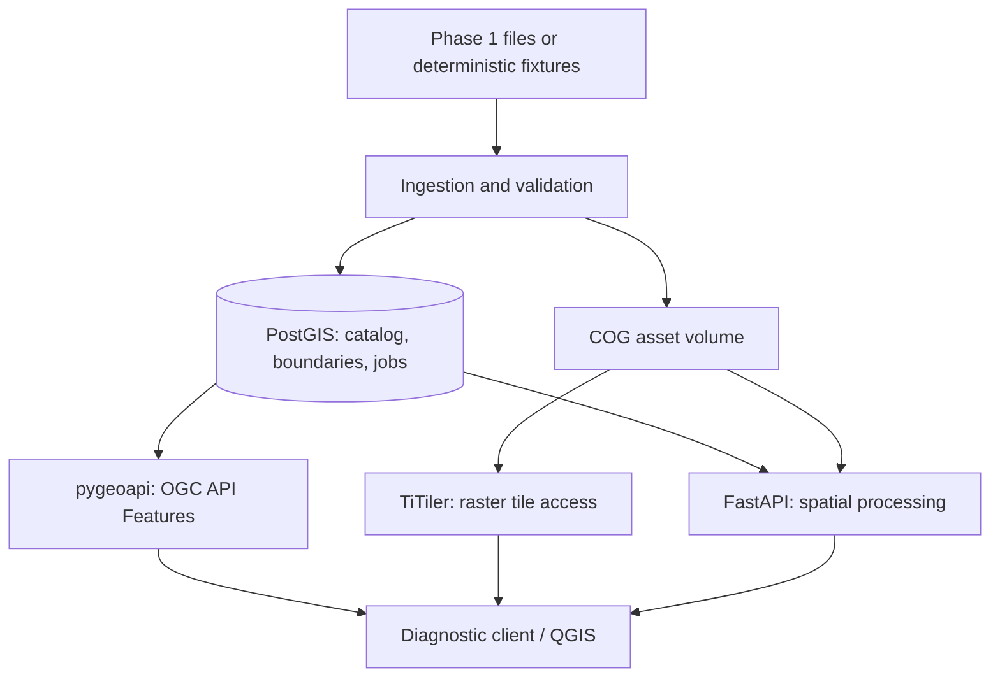

# Target architecture and ownership boundaries

## Logical data flow

## Deployment topology

- Compose service names (interface contract): `db`, `ingestion`, `ogc`, `tiles`, `processing`, `gateway`, `viewer` (viewer may be static behind gateway). Optional `worker` and `redis` only if explicitly justified by Agent 5 and integrated by Agent 6.
- Host gateway: `http://localhost:8080` by default. Route OGC under `/ogc/`, raster tiler under `/tiles/`, custom processing under `/api/`, and diagnostic viewer under `/` or `/viewer/`.
- Database address INSIDE Compose: `db:5432`; database/schema/user settings injected with environment variables; no hardcoded passwords.
- Shared raster volume INSIDE relevant containers: `/data/assets`. Source fixture files may live in `data/fixtures/`, generated locally and excluded from Git if large.
- PostGIS stores vector features, geographic units, dataset metadata, spatial indexes, job records. Rasters remain primarily as COG files. A SMALL optional PostGIS Raster test table may demonstrate `ST_Clip` and `ST_SummaryStatsAgg` and compare approaches.
- Ingestion uses one shared metadata contract; no special cases keyed on years, region, WorldPop brand, or Level 1/2. Product tags are metadata.
- pygeoapi provides OGC API Features for vector features and collections. A publication adapter/generated configuration is acceptable, provided updates require no hand-editing and are documented.
- TiTiler provides the raster rendering engine. **OGC API Tiles is a Phase 2 target, not merely a TiTiler tile URL.** Agent 4 must implement and verify an OGC API Tiles-compliant publishing layer/adapter (using pygeoapi or a small standards-aware adapter if needed). Never claim default TiTiler routes satisfy the standard solely because they return tiles.
- OGC API Coverages is a draft specification; any coverage API support must be documented as experimental and not misrepresented as finalized conformance.
- FastAPI handles project-specific processing requests (clipping, zonal stats, exports, job status). Do not mislabel custom routes as OGC standard endpoints.
- Full user auth/RBAC and polished UI are Phase 4. In Phase 2 avoid a public unauthenticated mutation endpoint; prefer ingestion CLI or protect write routes with a local admin secret.

## Repository module ownership

| Path | Sole initial owner | Notes |
|---|---|---|
| `infra/`, root `compose.yaml`, `.env.example`, `Makefile` | Agent 1 | Other agents may supply config requests under their own module, not edit this concurrently |
| `database/` | Agent 2 | Schema, migrations, spatial SQL and DB docs |
| `ingestion/` | Agent 3 | File validation, COG conversion, dataset registration, synthetic fixture generator |
| `ogc-services/` | Agent 4 | pygeoapi config/adapters, conformance checks, OGC docs |
| `spatial-processing/` | Agent 5 | FastAPI, processing library, export/job logic |
| `demo-client/`, `tests/e2e/`, `docs/integration/` | Agent 6 | Diagnostic viewer, end-to-end validation, final merges |

Use per-service dependency manifests (`pyproject.toml` or `requirements.txt`) INSIDE owned directories to prevent root dependency conflicts. Shared contracts under `contracts/` are created once in Agent 1's baseline and treated read-only by Agents 2–5; proposals go to `docs/contract-change-requests/agentN.md`.

## Operational requirements

- Pin container images/dependency versions to reproducible release versions, not floating `latest` in final deployment.
- Health checks must distinguish booted from ready. Startup should wait for DB readiness and successful migrations.
- Stop failed ingestion safely: no half-published active dataset; record status/error; retries should be idempotent.
- Always carry CRS, units, NoData policy, and source provenance through transformations and exports.
- Geometries used for geographic joins should have GiST indexes and use explicit SRID transformations where necessary.
- Keep access to raster files server-side; do not interpolate arbitrary untrusted file paths into tile/processing URLs.
