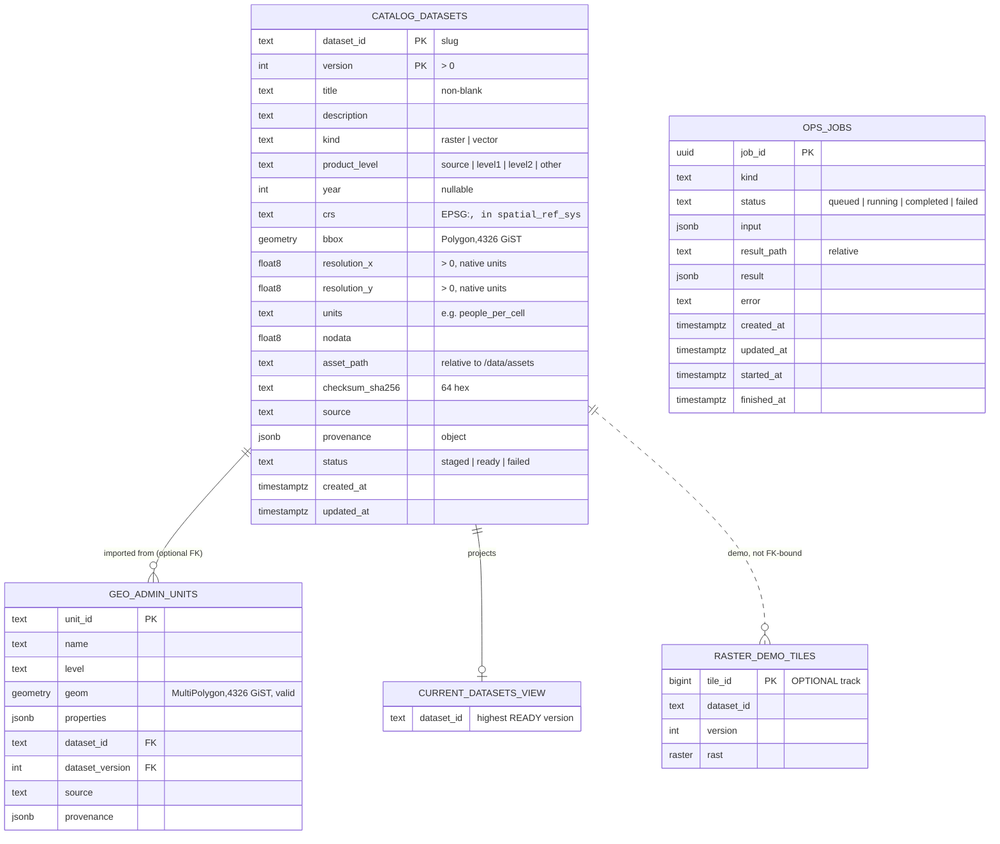

# `database/`: PostGIS schema, migrations and spatial SQL

**Owner:** Agent 2 (PostGIS), the sole initial owner per `contracts/ARCHITECTURE.md`.

This module implements the frozen v1 contract in `contracts/SHARED_CONTRACTS.md` for the `catalog`,
`geo` and `ops` schemas. It contains:

- versioned SQL migrations and a migration CLI;
- spatial query primitives, in SQL and as Python wrappers;
- a fixture loader that is independent of the ingestion service;
- an optional, clearly separated PostGIS Raster demo;
- PostGIS integration tests.

It contains **no** population modelling, interpolation, OGC server or frontend code.

```
database/
├── cgis_db/                 Python package: CLI, migration runner, queries, fixture loader, explain
├── migrations/
│   ├── core/                REQUIRED: 0001 extensions … 0006 access roles (each has .up/.down.sql)
│   └── raster_demo/         OPTIONAL PostGIS Raster demonstration track
├── fixtures/                synthetic_towns.stub.geojson: database TEST STUB (Agent 3 owns the real generator)
├── tests/                   pytest integration tests (real PostgreSQL/PostGIS, no mocks)
├── docs/                    EXPLAIN_ANALYZE.md, RASTER_DEMO.md, contract-change-request.md
├── HANDOFF_REPORT.md
└── pyproject.toml           deps: psycopg[binary] 3.x; tests: pytest
```

## Quick start

```bash
cd database
python -m pip install -e ".[test]"         # or: pip install "psycopg[binary]>=3.1,<4" pytest

export CGIS_DATABASE_URL=postgresql://USER@HOST:5432/DBNAME   # password via PGPASSWORD / ~/.pgpass
python -m cgis_db migrate up               # apply core migrations (safe to re-run)
python -m cgis_db migrate status
python -m cgis_db fixtures load            # SYNTHETIC Town A / Town B + catalog row "synthetic-towns"
python -m cgis_db fixtures load --geojson /data/fixtures/synthetic_towns.geojson   # Agent 3's file
python -m cgis_db explain > plans.md       # EXPLAIN ANALYZE samples (benchmark data rolled back)
python -m cgis_db raster-demo              # OPTIONAL PostGIS Raster demo
```

The CLI exits with `0` on success, `1` on a database or migration error (one-line `error: …` on
stderr, with no traceback and no password), and `2` on a usage error.

### Connection environment variables

| Variable | Meaning |
|---|---|
| `CGIS_DATABASE_URL` | libpq URL/conninfo used by the CLI (highest priority after `--dsn`) |
| `DATABASE_URL` | fallback URL |
| `PGHOST`, `PGPORT`, `PGDATABASE`, `PGUSER`, `PGPASSWORD`/`PGPASSFILE`, `PGSSLMODE` | standard libpq variables, used when neither URL is set |
| `CGIS_DB_MIGRATIONS_DIR` | optional override of the migrations directory |
| `CGIS_TEST_ADMIN_DSN` | **tests only**: a role allowed to `CREATE/DROP DATABASE` |

Inside Compose the address is `db:5432` (`contracts/ARCHITECTURE.md`). No password is hard-coded
anywhere in this module.

## Entity-relationship diagram



`cgis_meta.schema_migrations(track, version, name, checksum_sha256, applied_at, applied_by)` is the
migration ledger. The `cgis` schema holds shared helper functions only.

## Schema and consumer contract

### `catalog.datasets` (write surface: Agent 3)

Every column in the contract is present, in contract order and with contract semantics. The full list
is in `tests/test_migrations.py::CONTRACT_DATASET_COLUMNS`. The CHECK constraints and the
`datasets_guard` trigger enforce these rules:

- **Identity:** `(dataset_id, version)` is the PK. The slug pattern rejects spaces, uppercase and
  `../`. `dataset_id` and `version` are immutable.
- **Enumerations:** `kind`, `product_level` and `status` only accept the contract values.
- **CRS:** `crs` must be `EPSG:<code>` **and** present in `spatial_ref_sys`.
- **bbox:** `geometry(Polygon,4326)`, valid, non-empty, inside lon/lat bounds. A wrong SRID or type
  is rejected by the typmod.
- **Paths:** `asset_path` must be a safe *relative* path. That rules out leading `/`, `..`, `.`,
  `//`, a backslash, a drive letter or URL scheme, control characters, and paths over 1024
  characters.
- **Completeness:** `status='ready'` requires `bbox` and `checksum_sha256`. A ready raster also
  requires `asset_path`, `units` and `resolution_x/y`.
- **Status lifecycle:**
  `staged → staged|ready|failed`, `failed → failed|staged`, `ready → ready|failed`.
  A `ready` row's content is **immutable**. To change the data, register a new version. To retract a
  version, set it to `failed`.
- **Timestamps:** `created_at` and `updated_at` are `timestamptz` and maintained by the trigger.

Writers can use plain `INSERT`/`UPDATE` (the constraints apply either way) or the helpers:

```sql
-- idempotent: returns outcome inserted | unchanged | updated; raises 23505 on conflict
SELECT * FROM catalog.register_dataset('{
  "dataset_id": "synthetic-worldpop-2001", "version": 1,
  "title": "SYNTHETIC population raster (2001)", "kind": "raster", "product_level": "source",
  "year": 2001, "crs": "EPSG:4326", "bbox": [78.0, 17.936, 78.064, 18.0],
  "resolution_x": 0.001, "resolution_y": 0.001, "units": "people_per_cell", "nodata": -9999,
  "asset_path": "synthetic/synthetic_2001.tif", "checksum_sha256": "<64 hex>",
  "source": "deterministic-fixture", "provenance": {"synthetic": true}, "status": "staged"}');
SELECT catalog.set_dataset_status('synthetic-worldpop-2001', 1, 'ready');
```

`bbox` in `register_dataset` may be `[xmin,ymin,xmax,ymax]` (EPSG:4326), a GeoJSON geometry
(EPSG:4326), or EWKT with an explicit SRID, which is transformed to 4326. When the same
`(dataset_id, version)` is registered again:

- **same content:** returns `unchanged`. A ready row is never downgraded, so an importer re-run is a
  no-op.
- **different checksum, or changed metadata on a ready row:** raises `unique_violation` with a
  clear message.

### `catalog.current_datasets` (read surface: Agents 4 and 5)

The view has the same 20 public columns, in the same order as the table. It returns one row per
`dataset_id`: the **highest `ready` version**. `staged` and `failed` versions are never visible, and
older versions are kept in the table. It is written as `NOT EXISTS (higher ready version)` rather
than `DISTINCT ON`, so `WHERE bbox && …` and `WHERE dataset_id = …` push down to the GiST and btree
indexes (see `docs/EXPLAIN_ANALYZE.md`).

### `geo.admin_units`

The contract columns `unit_id` (PK), `name` (NOT NULL), `level` and
`geom geometry(MultiPolygon,4326)` (NOT NULL) are all present. Extra columns hold imported
attributes and provenance: `properties`, `dataset_id`/`dataset_version` (FK to the catalog),
`source`, `provenance` and timestamps. `geom` is valid, 2D, non-empty and inside lon/lat bounds.

Write through `geo.upsert_admin_unit(...)`, which calls `geo.normalize_multipolygon(geom, repair)`.
That function:

- accepts Polygon or MultiPolygon in **any CRS with an explicit SRID** and transforms it to 4326;
- forces 2D and promotes the result to MultiPolygon;
- rejects SRID 0, invalid geometries (with `ST_IsValidReason`), empty geometries and non-areal
  types;
- repairs a geometry with `ST_MakeValid` only when `repair => true` is passed explicitly.

An existing `unit_id` that belongs to *another* dataset is never overwritten. PostGIS ≥ 3.6 also
promotes a Polygon to MultiPolygon at the column typmod for direct INSERTs.

### `ops.jobs`

The contract columns are present, plus `result jsonb`, `started_at` and `finished_at`. The lifecycle
is enforced by CHECKs and a trigger:

```
queued ──► running ──► completed
   │          └──────► failed
   ├──────────────────► completed   (synchronous job)
   └──────────────────► failed      (rejected / cancelled)
```

- `error` is non-blank **if and only if** the status is `failed`.
- `completed` **requires** `result_path` and/or `result`. Non-completed jobs carry neither.
- `finished_at` is set if and only if the job is terminal. `started_at` is set when the job is
  running.
- `kind` and `input` are immutable. Terminal rows cannot be modified.
- `result_path` follows the same safe-relative-path rule as `asset_path`.

The helpers are `ops.create_job(kind, input)`, `ops.start_job(id)`,
`ops.complete_job(id, result_path, result)` and `ops.fail_job(id, error)`.

### Access roles (`0006`)

The migration creates three `NOLOGIN` group roles:

| Role | Intended user | Grants |
|---|---|---|
| `cgis_reader` | OGC service | SELECT on catalog and geo, plus the read functions |
| `cgis_ingest` | ingestion | INSERT/UPDATE on `catalog.datasets` and `geo.admin_units`, plus the helpers |
| `cgis_processing` | processing service | the read grants, plus INSERT/UPDATE on `ops.jobs` |

Infrastructure creates the login users and runs, for example, `GRANT cgis_reader TO ogc_user`. If
the migrating role lacks `CREATEROLE`, role creation is skipped with a NOTICE.

## Spatial query primitives

All primitives are `STABLE` SQL functions. Each one transforms the **query** geometry to EPSG:4326
and never the indexed column, so GiST stays usable. Every geometry argument must carry an explicit
SRID. EPSG:4326 input with out-of-range coordinates (usually projected coordinates labelled as
4326) is rejected.

| Function | Purpose |
|---|---|
| `catalog.resolve_dataset(id)` | bare `dataset_id` → current ready version (0 or 1 rows) |
| `catalog.datasets_in_bbox(xmin, ymin, xmax, ymax, srid=4326, kind=NULL)` | bbox discovery over current datasets |
| `catalog.datasets_intersecting(geom, kind=NULL)` | footprint intersection with any geometry |
| `geo.units_in_bbox(xmin, ymin, xmax, ymax, srid=4326, level=NULL)` | units whose geometry **intersects** the bbox (OGC bbox semantics); bbox in any CRS, densified before reprojection |
| `geo.units_intersecting(geom, level=NULL)` | `ST_Intersects` with automatic CRS transformation |
| `geo.units_covered_by(aoi, level=NULL)` | polygon-based selection: units entirely inside the AOI |
| `geo.unit_overlap(aoi, level=NULL)` | per-unit geodesic area, overlap area (m²) and fraction |
| `geo.summarize_units(aoi=NULL)` | aggregation by `level`: count, geodesic area (m²), WGS84 extent |
| `cgis.to_4326(geom)`, `cgis.envelope_4326(...)`, `cgis.srid_from_crs('EPSG:n')`, `cgis.is_safe_relative_path(p)` | shared helpers |

Python wrappers in `cgis_db/queries.py` bind every value as a parameter and exchange geometries as
GeoJSON:

```python
from cgis_db import queries
from cgis_db.connection import connect

with connect() as conn:
    queries.resolve_dataset(conn, "synthetic-worldpop-2001")
    queries.units_in_bbox(conn, (78.009, 17.979, 78.021, 17.991))                 # -> [town-a]
    queries.units_intersecting(conn, aoi_geojson_in_utm, crs="EPSG:32644")
    job = queries.create_job(conn, "clip", {"dataset_id": "synthetic-worldpop-2001"})
```

Example SQL:

```sql
-- bbox in Web Mercator
SELECT unit_id, name FROM geo.units_in_bbox(8683365, 2034290, 8685147, 2036378, 3857);
-- AOI drawn in UTM 44N
SELECT unit_id FROM geo.units_intersecting(
    ST_Buffer(ST_SetSRID(ST_MakePoint(183857, 1991070), 32644), 300));
-- all current raster datasets covering Town A
SELECT dataset_id, version, asset_path, units, nodata
  FROM catalog.datasets_intersecting((SELECT geom FROM geo.admin_units WHERE unit_id = 'town-a'), 'raster');
-- per-level summary
SELECT * FROM geo.summarize_units();
```

## Index rationale

| Index | Why |
|---|---|
| `catalog.datasets_bbox_gist` (GiST on `bbox`) | bbox and footprint discovery (`&&`, `ST_Intersects`), including through the view |
| `catalog.datasets_ready_latest_idx` (`dataset_id, version DESC`) `WHERE status='ready'` | partial index behind the current-version anti-join and `resolve_dataset`. It serves index-only scans |
| `catalog.datasets_kind_year_idx` | listing by kind and year, e.g. raster datasets for a given year |
| `geo.admin_units_geom_gist` | every spatial filter on units |
| `geo.admin_units_level_idx`, `admin_units_dataset_idx` | level filters, and the FK lookup when a dataset version is withdrawn or deleted |
| `ops.jobs_status_created_idx`, `jobs_kind_created_idx` | worker queue polling (`status='queued' ORDER BY created_at`) and recent jobs by kind |
| `raster_demo.tiles_hull_gist` (expression GiST) | tile selection for `ST_Clip` (optional track only) |

`docs/EXPLAIN_ANALYZE.md` shows these plans on a ~22.5k-unit and 15k-row synthetic benchmark, and
the seq-scan anti-pattern you get when the indexed column is transformed. The tiny fixture is
deliberately **not** used to claim speedups.

## Migrations: guarantees, rollback and constraints

- `python -m cgis_db migrate up|down|status [--track core|raster_demo] [--target N] [--steps N]`.
- Each migration runs in its **own transaction** together with its ledger row. A failure leaves the
  previous version intact.
- A session **advisory lock** serialises concurrent runners, for example several containers starting
  together.
- **Idempotent:** re-running `up` is a no-op. Each `up.sql` also uses `IF NOT EXISTS` and `OR REPLACE`,
  so even a manual re-execution is safe (this is tested).
- **Drift detection:** the ledger stores a SHA-256 of each applied file, with line endings normalised
  so CRLF checkouts do not count. `up` and `down` refuse to run if an applied migration was edited.
  **Never edit an applied migration; add a new one.**
- **Rollback:** every migration has a `.down.sql`. Down scripts **never use `CASCADE`**. For
  example, `0001` refuses to drop PostGIS while something else uses it. Rolling back
  `0003_catalog` deletes all catalog rows and `0004_geo` deletes all units, so treat `down` as a
  development tool. In production, roll forward with a new migration.
- Roles are cluster-wide. `0006.down` revokes this database's grants and only drops a role when no
  other database still references it.
- The optional `raster_demo` track requires core ≥ 2. `down` refuses to remove core below that while
  the demo is installed.
- **Requirements:** PostgreSQL ≥ 14 (`CREATE OR REPLACE TRIGGER`, `gen_random_uuid()`) and
  PostGIS ≥ 3.1. These are checked in `0001`. The tests ran on PostgreSQL 18.4 with PostGIS 3.6.2.

## Tests

The tests are real integration tests. Each session creates throw-away `cgis_test_*` databases and
drops them afterwards.

```bash
# any PostGIS server, e.g. a disposable container (pin the image tag):
docker run --rm -d --name cgis-test-db -p 55432:5432 -e POSTGRES_HOST_AUTH_METHOD=trust postgis/postgis:16-3.4
export CGIS_TEST_ADMIN_DSN=postgresql://postgres@localhost:55432/postgres
cd database && python -m pytest
```

The suite covers:

| File | Coverage |
|---|---|
| `test_migrations.py` | fresh apply twice, concurrent runners, schema introspection against the contract, GiST presence, full and partial rollback, no-cascade safety, drift, CRLF, optional-track dependency |
| `test_catalog.py` | 30 constraint rejections; idempotent, conflicting, staged → ready registration; bbox input forms and CRS transform; the current-version view; immutability; SQL-injection inertness; 6-way concurrent registration |
| `test_geo.py` | synthetic towns import as valid MultiPolygons with exact extents; normalisation; invalid, empty, no-SRID and wrong-type rejection; opt-in repair; one, both or neither bbox selection; UTM and Web Mercator AOIs; mislabelled-CRS detection; covered-by; geodesic overlap and aggregation |
| `test_jobs.py` | lifecycle, terminal immutability, status/result/error consistency |
| `test_raster_demo.py` | Town A/B sums 100/200 and 25/50; NoData exclusion (16 valid, 48 excluded); disjoint AOI; projected AOI; pixel-centre vs all-touched; clean removal |
| `test_explain_and_cli.py` | asserted GiST plan shapes; CLI end-to-end; redacted errors |

## Integration notes for Agents 1 and 6 (not edited here)

- Run `python -m cgis_db migrate up` once `db` is healthy and **before** ingestion, OGC or processing
  start, e.g. as a one-shot `db-migrate` service or an ingestion entrypoint step. It is safe to run
  repeatedly and concurrently.
- Seed: `python -m cgis_db fixtures load --geojson /data/fixtures/synthetic_towns.geojson` loads
  Agent 3's file. Otherwise Agent 3's importer can call `catalog.register_dataset` and
  `geo.upsert_admin_unit` directly.
- The image needs PostGIS ≥ 3.1. The optional demo also needs `postgis_raster` (included in the
  `postgis/postgis` images).
